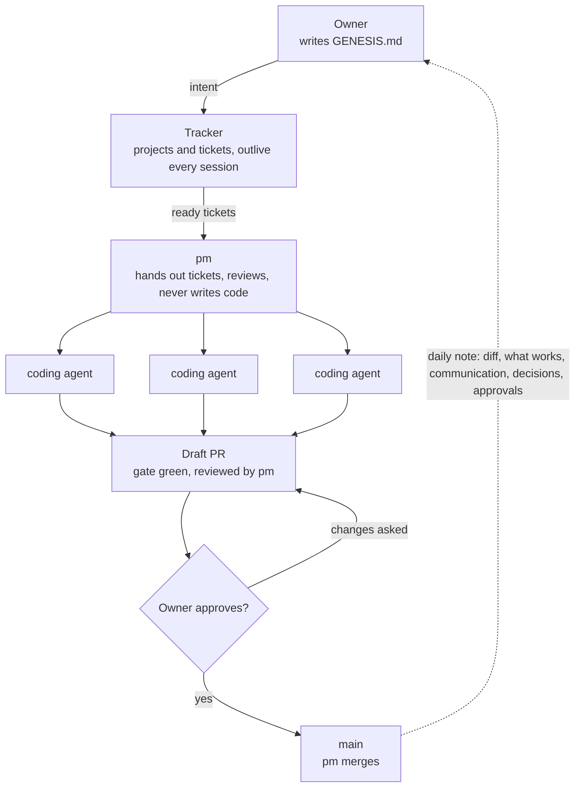

# FACTORY.md — the software factory

This file says how work moves from the owner's intent to merged code, with agents doing the work in between. It holds nothing about the product: that is `factory/GENESIS.md`. Every value that differs between repositories (the owner, the tracker, the number of agents, the gate command) lives in `factory/CONFIG.md`.

To use the factory in another repository, copy `FACTORY.md` and `roles/` unchanged, fill in `CONFIG.md`, and write that repository's `GENESIS.md`. `roles/pm.md` and `roles/coder.md` are the working instructions for the two kinds of agent sessions. Every agent reads all three before it starts; where they disagree, GENESIS.md wins on what to build, CONFIG.md on the values, and this file on the process.

## The four parts



- **Source: the owner.** Says what to build, in GENESIS.md and in conversation with pm. Approves every merge that the merge rule in CONFIG.md reserves for the owner.
- **Sink: the tracker.** Holds every piece of intended work as a ticket. Tickets outlive every session and every agent.
- **Gate: pm.** The one agent between the tracker and the coding agents. It decides what runs, reviews what comes back, and is the only agent the owner talks to.
- **Drain: the coding agents.** As many as CONFIG.md allows, each on one ticket.

The factory runs for days without the owner, up to the point where a PR is ready. The merge rule in CONFIG.md says which PRs wait for the owner's review, such as every design decision, and which pm may merge itself, such as a faithful implementation of a decided design. The owner's review is the bottleneck by design; pm keeps it small by listing the waiting PRs in the daily note and keeping PRs small.

## The life of a ticket

A ticket moves through these steps. Each step has one owner, and nothing skips a step.

1. **Intent.** The owner writes or changes GENESIS.md, or tells pm what they want.
2. **Ticket.** pm turns the intent into tickets in the tracker: one outcome each, with acceptance criteria and dependencies. Before writing one, pm checks that no ticket already covers it.
3. **Ready.** A ticket is ready when its dependencies are done or are open PRs it can build on, and nothing in it needs the owner.
4. **Assigned.** pm hands the ticket to a coding agent, if a lane is free and no running agent touches the same files.
5. **Built.** The agent works on the ticket's own branch, runs the gate until it is green, and opens a draft PR that names the ticket.
6. **Reviewed.** pm reviews the PR against the ticket and GENESIS.md. The agent fixes what pm, CI or a reviewer finds.
7. **Waiting for the owner.** When the merge rule in CONFIG.md reserves the PR for the owner, pm lists it in the daily note, and it waits until the owner approves it. A PR the merge rule lets pm merge skips this step, and pm lists it in the next daily note after the merge. CONFIG.md says whether the PR still holds its lane while it waits; its coding session stays open either way, to answer review.
8. **Merged.** pm merges, closes the ticket, and archives the coding session, which frees its lane if it still held one.

A ticket that depends on an unmerged PR does not wait: its agent branches from that PR (a stacked PR), and pm merges the stack in order.

## What pm does and never does

pm is the gate between the tracker and the agents, and the only agent the owner talks to.

pm does:

- Turns the owner's intent into projects and tickets, in priority order.
- Decides which ready tickets run, and which may run side by side so that no two agents edit the same files.
- Starts coding agents up to the number in CONFIG.md, plus an expedite lane when the owner calls a ticket urgent. It winds that lane down once the ticket ships.
- Reviews every PR before it reaches the owner, and sends it back when it does not meet its ticket or GENESIS.md.
- Records its own calls in the decision log.
- Writes the daily note.

pm never:

- Writes product code.
- Merges a PR that the merge rule reserves for the owner without the owner's approval.
- Starts more agents than CONFIG.md allows.
- Decides what GENESIS.md says needs the owner.

## Rules for every coding agent

- **One ticket, one branch, one PR.** Work only on the ticket pm gave you, on its own branch. A change outside its scope becomes a new ticket, not part of this PR.
- **Name the ticket.** Every commit message and PR title carries the ticket id, so the history leads back to the ticket.
- **Test first.** Work in red-green-refactor cycles: a failing test for each behaviour, committed before the code that makes it pass, so the history shows the red step.
- **Small files, one concern each.** No code or test file grows past the limit in CONFIG.md. A file that would is a sign that it mixes concerns: split it along them, in its own refactor commit with the tests green, instead of letting it grow.
- **Rewrite, don't append a correction.** When a change makes existing text wrong or incomplete, rewrite the passage so that it reads as one consistent statement, as if it had been written that way from the start. Never leave the old sentence and add one that takes it back ("it sees more than that", "that is not all").
- **Green before ready.** Run the gate command from CONFIG.md until it passes. Never weaken a gate to get there.
- **Promises become tickets.** Anything you would do "later" goes into a ticket or the PR, never only into your session: the session ends, the ticket stays.
- **Record your calls.** A decision a reviewer could question goes into the decision log with the ticket id.
- **Stop when the ticket needs the owner.** If the work hits something GENESIS.md reserves for the owner, stop, say so on the ticket, and tell pm.
- **Answer your PR.** Fix failing CI and review comments on your PR until pm marks it done.

## What goes to the owner

Two kinds of things wait for the owner:

- **Merges.** Every PR that the merge rule in CONFIG.md reserves for the owner.
- **Decisions GENESIS.md reserves for the owner.** The product decides what these are, so GENESIS.md lists them, not this file.

Each question to the owner becomes its own ticket, assigned to the owner, with the label from CONFIG.md. It is one question that can be answered from a phone, with the options and pm's recommendation. Work that depends on it waits; everything else goes on. The ticket stays open until the owner answers, so a question cannot get lost in a note.

## The decision log

The decision log records every call that shapes the product or the code and is not obvious from the diff. It is a folder (path in CONFIG.md) with one file per decision, so two PRs never edit the same file and never conflict over it. Agents add files; nobody edits an old one. A decision that is reversed gets a new file that names the old one in `Supersedes:`; the old one is then superseded, without being touched.

Each file is named `YYYY-MM-DD-<ticket>-<slug>.md`, with `no-ticket` when there is none (for example `2026-11-07-NOC-12-relay-writes-one-table-per-space.md`), and holds one entry:

```markdown
# 2026-11-07 · NOC-12 · Relay writes go through one DynamoDB table per space

- Decided by: pm (or the owner's name, when the owner decided)
- Why: one line
- Instead of: the option not taken, one line
- Topics: relay, aws
- Supersedes: 2026-11-06-NOC-9-an-older-decision.md   (optional)
```

`Topics:` is required: lowercase tags, so a reader finds every decision on a subject. The gate checks every file's name, heading and fields. No generated overview is committed, since it would change in every PR; the reading command in CONFIG.md prints the whole log in date order, an index, only the current decisions, or the decisions of one ticket, topic or period.

A decision the owner made carries the owner's name and the date. Agents read the log's index before they start (`pnpm decisions --index`), and in full the decisions of their ticket, the tickets it depends on and the topics it touches (`--ticket`, `--topic`), so they do not reopen settled questions without reading the whole log every time.

## How the owner hears back

pm posts one note a day as a status update on the initiative in CONFIG.md, which sits above all projects. The update sets the initiative's health (on track, at risk, off track) and says, in plain words:

1. What shipped, with PR and ticket.
2. Which PRs wait for the owner, the one that blocks most first.
3. What broke or is blocked.
4. What pm decided without the owner.
5. The open questions to the owner, each linked to its ticket.

## Running it

The factory runs in Claude Code cloud sessions, in the environment named in CONFIG.md. Nothing in a session survives it: state lives in the tracker, the repository and the decision log.

| Part          | How it runs                                                                                                                                                                                                                                                                             |
| ------------- | --------------------------------------------------------------------------------------------------------------------------------------------------------------------------------------------------------------------------------------------------------------------------------------- |
| pm            | One long-lived cloud session. A scheduled task wakes it at a fixed interval to look at the tracker and the running agents, and once a day for the note. A new pm session takes over the scheduled tasks and the running coding sessions from the old one, so there is only ever one pm. |
| Coding agents | One cloud session per ticket, started by pm, each in its own container on its own branch. pm sends it the ticket id, its own session id and the pointer to `roles/coder.md`, nothing else; the agent reads the rest.                                                                    |
| PR follow-up  | Each coding session subscribes to its PR, so CI results and review comments wake it.                                                                                                                                                                                                    |
| Messages      | pm and the coding sessions talk through session messages. The owner talks only to pm.                                                                                                                                                                                                   |
| Expedite lane | pm starts one more session for an urgent ticket and archives it once the ticket is merged.                                                                                                                                                                                              |

To set up the factory in a new repository:

- [ ] Copy `FACTORY.md` and `roles/` into `factory/`.
- [ ] Write `factory/CONFIG.md` and `factory/GENESIS.md`.
- [ ] Create an empty decisions folder, with the reading command and its check in the gate, and name both in CONFIG.md.
- [ ] Point `AGENTS.md` (or `CLAUDE.md`) at the three files, to be read before any work.
- [ ] Connect the tracker to the cloud sessions.
- [ ] Set up the cloud environment and test its setup script in a fresh session.
- [ ] Start a cloud session with the message "Read factory/roles/pm.md and act as pm." Its first run creates the initiative, the label and its scheduled tasks. To replace pm later, for example after a settings change, start a new session the same way: it takes over from the old one.
